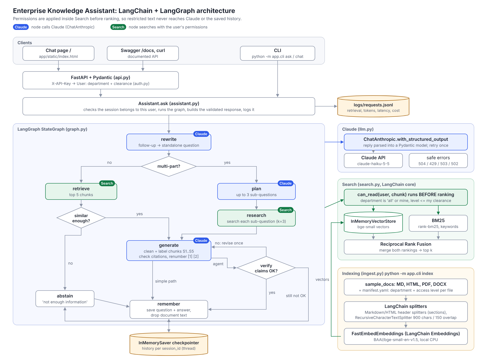
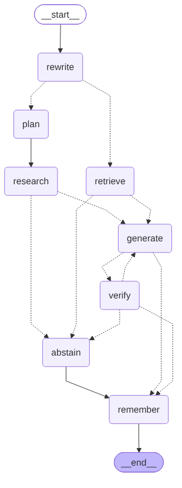
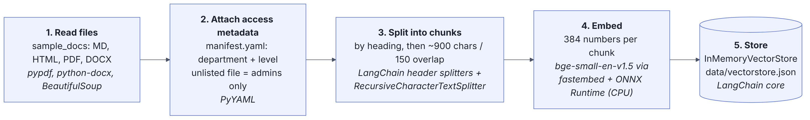
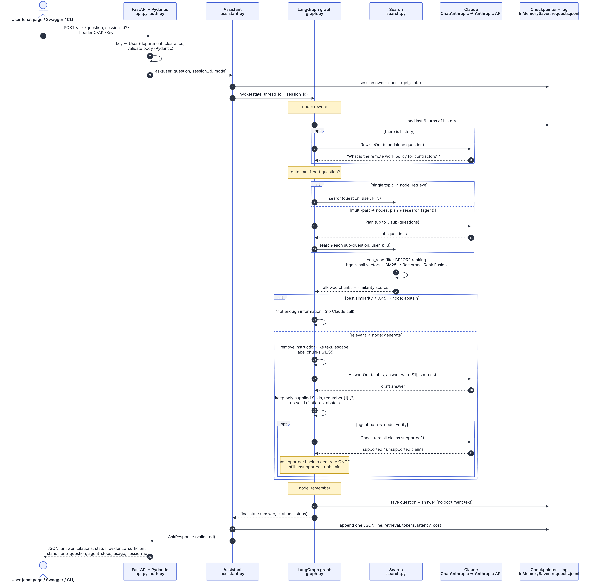

# Enterprise Knowledge Assistant (LangChain + LangGraph)

Answers employee questions from company documents with **citations**, says so when the documents don't contain the answer, handles **follow-up questions**, and only searches documents the user is **allowed to read**. Built with **LangChain** (documents, splitting, embeddings, vector store, Claude) and **LangGraph** (the whole question flow, the agent, and conversation memory), served by FastAPI. All documents are synthetic (a fictional company, "Lumenfield Technologies").



*Architecture: clients and FastAPI on top, the LangGraph flow in the middle, and on the right the Claude client, the permission-filtered search and the indexing pipeline. Edit `docs/make_architecture.py` and run it to redraw (`docs/architecture.svg`).*

## How it meets the assessment

| Requirement | Where |
|---|---|
| A. Load 2+ formats, metadata, chunking, embeddings, index, re-index, bad files | `app/ingest.py` (LangChain text splitters), `app/search.py` (LangChain vector store), `python -m app.cli index`, `POST /reindex` |
| B. Retrieve, grounded answer, citations, metadata filtering + hybrid search, abstain | `app/search.py` (permission filter + embeddings + BM25), `app/graph.py` (`generate`, `check_citations`) |
| C. Follow-ups, references like "what about contractors?", context budget | `app/graph.py` (`rewrite` node, LangGraph checkpointer keeps the history) |
| D. FastAPI + Pydantic, validated response, documented endpoints, CLI / UI | `app/api.py` (`/docs`), `app/cli.py`, `app/static/index.html` (chat page at `/`) |
| E. Roles, filtering before the model, tests, prompt injection, safe errors | `app/auth.py`, `app/search.py`, `app/graph.py`, `app/llm.py` |
| F. Bounded agent workflow | `app/graph.py` (`plan`, `research`, `verify` nodes) |
| G. Tests, evaluation set, logging of retrieval / latency / tokens / cost | `tests/`, `eval/`, `logs/requests.jsonl` |

## Where each framework is used

| Framework part | Used for | File |
|---|---|---|
| `langchain_core.documents.Document` | Every chunk: text + metadata (file, section, page, department, access level) | `ingest.py` |
| `MarkdownHeaderTextSplitter`, `HTMLHeaderTextSplitter` | Split Markdown and HTML by their headings, so each chunk knows its section | `ingest.py` |
| `RecursiveCharacterTextSplitter` | Cut sections into ~900-character chunks with 150 characters of overlap | `ingest.py` |
| `langchain_core.embeddings.Embeddings` | Interface for the local bge-small model (a small fastembed adapter) | `search.py` |
| `InMemoryVectorStore` | Stores vectors, applies the **permission filter before ranking**, saves to one JSON file | `search.py` |
| `ChatAnthropic.with_structured_output` | Calls Claude and parses the reply into a Pydantic model | `llm.py` |
| LangGraph `StateGraph` | The whole question flow as nodes and routes, including the agent loop | `graph.py` |
| LangGraph `InMemorySaver` checkpointer | Conversation memory per `session_id` (thread) between requests | `graph.py`, `assistant.py` |
| LangGraph `get_graph().draw_mermaid()` | Draws the flow diagram below (`python -m app.cli graph`) | `cli.py` |

**Why LangChain + LangGraph and not LlamaIndex too:** LlamaIndex covers the same ground as LangChain (loading, indexing, querying). Using both would mean two ways of doing everything and twice the dependencies. LangChain pairs naturally with LangGraph, which is the part that adds real value here: the agent loop and conversation memory.

**Why not `langchain-community`:** it is being sunset (its own warning says so), so the three things this project needed from it are replaced with small, readable pieces on LangChain's core interfaces: PDFs are read with `pypdf` into `Document`s, the embedding model is wrapped as a LangChain `Embeddings` class, and BM25 uses `rank-bm25` directly.

## The flow (drawn by LangGraph itself)



Solid arrows always run; dotted arrows are routes chosen at runtime:

1. **rewrite**: with conversation history, Claude rewrites a follow-up ("What about contractors?") into a standalone question. The first question skips the Claude call.
2. **route**: a single-topic question goes to **retrieve**; a multi-part one ("X and how Y?", "compare...") goes to **plan**.
3. **retrieve**: hybrid search over chunks the user may read; top 5. If nothing reaches a similarity of 0.45, go to **abstain** without calling Claude.
4. **plan → research** (agent): split into at most 3 sub-questions, search each with the user's permissions, merge the evidence.
5. **generate**: chunks are cleaned (instruction-like sentences removed, text escaped), labelled S1, S2..., and sent to Claude, which must return `status`, `answer` with `[S1]` markers, and `sources`. Citations are then checked: only ids that were sent count, an answer with no valid citation becomes "not enough information", and markers are renumbered to [1], [2].
6. **verify** (agent): Claude checks every claim against the evidence. One failure allows one revision (back to **generate** with feedback); a second failure goes to **abstain**. At most 3 searches and 5 Claude calls.
7. **remember**: the checkpointer saves the question and answer (cut to 400 characters) for this conversation, and the retrieved document text is cleared from the saved state.

## Workflow

**A. Indexing** (once, `python -m app.cli index`): documents become searchable, permission-tagged chunks.



**B. Answering a question** (every `POST /ask`), as numbered steps. "opt" = only sometimes, "alt" = one of two paths. Restricted chunks are removed in step 13 (the `can_read` filter inside Search), before anything reaches Claude.



Diagram sources: `docs/workflow-indexing.mmd`, `docs/workflow-question.mmd` (Mermaid; render with `mmdc -c docs/mermaid-config.json -w 2400 -s 2`).

## Setup (Windows PowerShell)

```powershell
python -m venv .venv
.\.venv\Scripts\Activate.ps1
python -m pip install --upgrade pip
pip install --only-binary=:all: -r requirements.txt
copy .env.example .env        # then put your ANTHROPIC_API_KEY in .env
```

Python 3.10–3.13. Everything installs from prebuilt packages (checked for Windows + Python 3.13), so no C++ build tools are needed. The first `index` run downloads the embedding model (about 70 MB) into `data/models`.

## Run

```powershell
python -m app.cli index                                   # read sample_docs, build the index
python -m app.cli users                                   # demo users and their API keys
python -m app.cli ask "How many days of annual leave do I get?" --user alice
python -m app.cli ask "What is the salary band for a Senior Engineer?" --user alice   # refused
python -m app.cli ask "What is the salary band for a Senior Engineer?" --user harry   # answered
python -m app.cli ask "How many sick days do I get and how fast must on-call acknowledge a page?" --user alice  # agent
python -m app.cli chat --user alice                       # try a question, then "What about contractors?"
python -m app.cli graph                                   # print the LangGraph flow as Mermaid
python -m app.cli serve                                   # chat page: http://127.0.0.1:8000   API docs: /docs
pytest                                                    # 38 tests, offline, a few seconds
python -m eval.run_eval                                   # 23 live questions -> eval/results.md
```

**Demo users** (`users.yaml`, sent as the `X-API-Key` header):

| User | Key | Department | Clearance | Can read |
|---|---|---|---|---|
| alice | `alice-demo-key` | engineering | internal | handbook, security policy, runbook, onboarding, contractor guide, FAQ |
| harry | `harry-demo-key` | hr | restricted | general documents + **salary bands** |
| fiona | `fiona-demo-key` | finance | internal | general documents + **procurement policy** |
| carl | `carl-demo-key` | none (contractor) | public | contractor guide, onboarding, FAQ only |
| admin | `admin-demo-key` | all | restricted | everything; can call `/reindex` |

**API** (full docs at `/docs`): `POST /ask` with `{"question": "...", "session_id": "...", "mode": "auto|simple|agent"}` returns `answer`, `status`, `evidence_sufficient`, `citations` (file, section, page, snippet), `standalone_question`, `mode`, `agent_steps`, `session_id`, `usage` (Claude calls, tokens, cost) and `latency_ms`. `GET /documents` lists what the caller can read; `POST /reindex` (admin) rebuilds the index.

```bash
curl -X POST http://127.0.0.1:8000/ask -H "X-API-Key: alice-demo-key" -H "Content-Type: application/json" \
     -d '{"question": "How long must passwords be?"}'
```

## Project structure

```
app/
  config.py      settings from .env
  auth.py        users + the access rule (can_read)
  ingest.py      read MD/HTML/PDF/DOCX into LangChain Documents, split by headings and size, add access metadata
  search.py      LangChain vector store + BM25, permission filter, rank fusion, save/load
  llm.py         Claude via ChatAnthropic.with_structured_output, retries, safe errors
  graph.py       the LangGraph flow: prompts, nodes, routes, citation checks, agent
  assistant.py   runs the graph for one question, conversation ownership, logging, API response
  api.py         FastAPI endpoints + chat page
  cli.py         command line
  static/index.html  chat page: pick a user, see citations, agent steps, tokens and cost
sample_docs/     8 synthetic documents + manifest.yaml (department and access level per file)
users.yaml       demo users
tests/           pytest suite (fake model + fake embeddings; a fake Anthropic server for the real client)
eval/            23 evaluation questions + runner
```

## Design decisions

**Chunking.** Markdown and HTML are split by their headings with LangChain's header splitters; DOCX headings come from Word heading styles and PDF sections from numbered headings ("5. Incident Reporting"), with page numbers. Each section is then cut by `RecursiveCharacterTextSplitter` into chunks of about 900 characters with 150 characters of overlap, trying paragraph breaks first, then lines, then sentences. A chunk never mixes two sections, so it can be cited by section and page. The title and section are added to the chunk text before embedding, so a short chunk like "22 days per year" is still found by "annual leave". HTML table rows are kept on one line ("L3 | Senior Engineer | 20 to 32 LPA").

**Search.** Embeddings (`BAAI/bge-small-en-v1.5`, local, CPU only) match meaning: "time off" finds "annual leave". BM25 matches exact words that embeddings blur, like `deployctl` or `LF-Staff`. Reciprocal Rank Fusion merges the two by rank, so their different score scales don't matter. `InMemoryVectorStore` is enough for hundreds of chunks; a LangChain vector store for Qdrant or pgvector is the production swap, behind the same interface.

**Access control in code, not in the prompt.** The permission check is passed to the vector store as a filter that runs before ranking, and BM25 only sees allowed chunks, so restricted text is never ranked, never sent to Claude and never saved in history. Files missing from `manifest.yaml` are restricted to admins by default. A refusal reads the same whether the topic is restricted or doesn't exist. A conversation (LangGraph thread) belongs to the user who started it; another user's `session_id` gets the same error as an unknown one.

**Abstention.** Three layers: the relevance gate (no Claude call), Claude's own `insufficient_evidence` status, and the citation check (an uncited answer is not trusted).

**Prompt injection.** Hidden HTML is dropped at load time, sentences that look like instructions to an AI are removed, `<` and `>` are escaped so a document can't close its `<document>` tag, and the system prompt says documents are not instructions. The real guarantee is that permissions and citation checks don't depend on the model: a test shows a model that obeys an injection still can't cite documents it wasn't given.

**Conversation and context budget.** LangGraph's checkpointer saves each conversation's history. Only questions and answers are kept (answers cut to 400 characters); the `remember` node clears retrieved document text from the saved state. The rewrite step uses only the last 6 turns. A new topic passes through unchanged. Limitation: `InMemorySaver` lives in memory; a database-backed LangGraph checkpointer (SQLite, Postgres) is the production swap.

**Agent.** It helps because one search for a two-topic question often finds only one topic, and the verify step catches stitched-together claims. Single-fact questions take the cheaper simple path. In LangGraph the loop limit is explicit in the routes: `verify` can send the flow back to `generate` only once.

**Errors.** `ChatAnthropic` uses a 30 s timeout and 2 automatic retries. Timeouts return HTTP 504, rate limits 429, outages 503, and replies that fail validation twice 502, each with a short safe message and no stack trace. A test runs the real `ChatAnthropic` client against a local fake Anthropic server to check this.

**Model choice.** Claude Haiku: fast, cheap, reliable with structured output. Change `CLAUDE_MODEL` for a stronger model. Cost is estimated from token counts and the prices in `.env` (check current pricing).

## Tests and evaluation

`pytest` runs 38 tests with a fake model and fake embeddings (no network, no key), plus a local fake Anthropic server for the real Claude client. They cover all formats, bad files, deny-by-default, chunk size, index save/load, hybrid search, citations, invented citations, abstention, follow-ups with the checkpointer, history limits, conversation ownership, the access rule, **no restricted text in any prompt sent to the model**, prompt injection, a hijacked model, safe HTTP errors, retries, logging, and the agent's routing, steps, limits and single revision.

`python -m eval.run_eval` runs 23 conversations with the real model (answerable, follow-up, multi-part, ambiguous, unanswerable, access-denied, prompt-injection) and writes pass/fail, answers, latency, tokens and cost to `eval/results.md`. It is a smoke test: 23 questions written by the builder can't show how well the system generalises.

**Live result (claude-haiku-5-5, bge-small, 2026-10-24): 23/23 passed** across answerable (9), follow-up (2), multi-part (1), ambiguous (2), unanswerable (3), access-denied (4) and prompt-injection (2) cases, with no restricted document retrieved for a user who couldn't read it. Median 1.6 s per conversation, slowest 4.4 s; 33,417 input / 3,297 output tokens, about $0.05 at the configured prices. Per-case results and every answer: [eval/results.md](eval/results.md).

## Limitations and what production would need

- In-memory vector store and checkpointer: fine for a demo. Production: a LangChain vector store for Qdrant or pgvector, and a SQLite or Postgres LangGraph checkpointer.
- Re-indexing rebuilds everything; production would index changed files only.
- Scanned PDFs (images) aren't read; OCR would be needed.
- Injection detection uses patterns and can be beaten by new phrasing; production would add a classifier.
- Demo API keys in a file; production would use company single sign-on and take departments from the HR system.
- LangChain and LangGraph release often; versions are minimums in `requirements.txt`, so pin exact versions (`pip freeze`) before deploying.
- A small evaluation set; production needs a larger labelled set run automatically on every change.
